<!--
Brouillon destiné à remplacer README.fr.md. Chemins d'images relatifs à la racine du dépôt.
Images : python3 docs/readme-charts/build_readme.py (sections) et build.py (graphiques du modèle affiné).
-->

<p align="center">
  <a href="https://steph.lsmdx.com">
    <picture>
      <source media="(prefers-color-scheme: dark)" srcset="assets/readme/banner.fr.dark.png">
      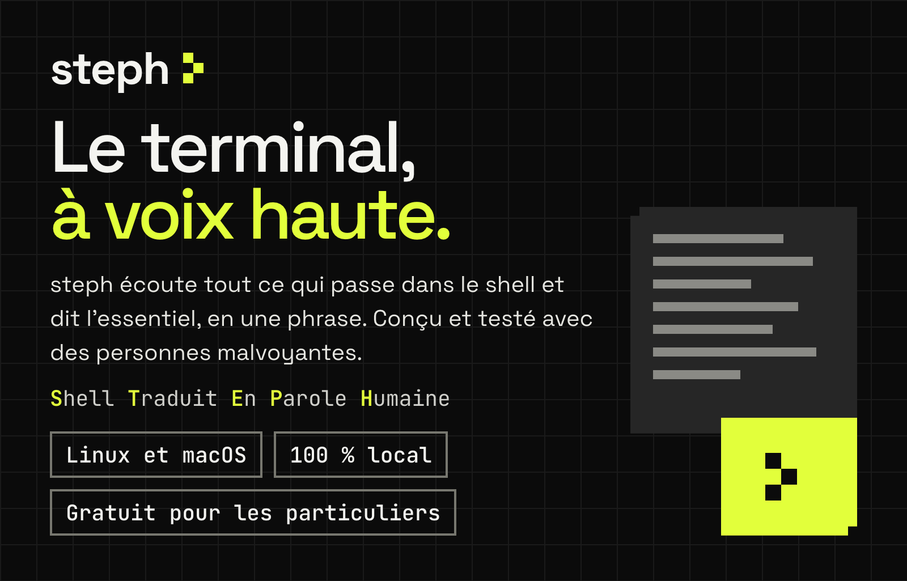
    </picture>
  </a>
</p>

<p align="center">
  <a href="LICENSE.md"></a>
  
  
  <a href="https://steph.lsmdx.com"></a>
</p>

<p align="center"><a href="README.md">English</a> · <strong>Français</strong></p>

<p align="center">
  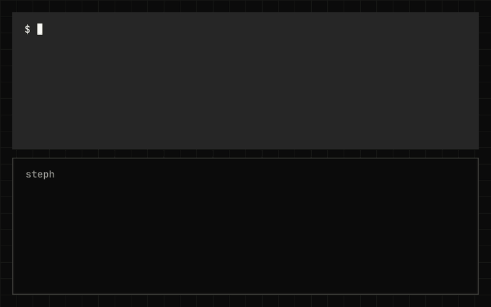<br>
  <sub>Phrases réelles du petit modèle livré. <a href="assets/demo-fr.mp4">Version avec le son (mp4)</a>, voix Piper fr_FR-siwis-medium.</sub>
</p>

# steph, le terminal qui parle

**S**hell **T**raduit **E**n **P**arole **H**umaine.

> Ton build échoue. Un lecteur d'écran te lit 40 lignes de trace, une par une.
> steph dit : *« Échec. Header.tsx ligne 42 : Property titel does not exist on type Props. Did you mean title? »*

`steph` relance ton shell (zsh ou bash, avec ta config habituelle) et écoute
tout ce qui passe. Au lieu de lire tout le texte à voix haute, il dit
**l'essentiel, en une phrase**. Conçu et testé avec des personnes malvoyantes.

Écouter la voix : [steph.lsmdx.com](https://steph.lsmdx.com/).

## Le problème

<picture>
  <source media="(prefers-color-scheme: dark)" srcset="assets/readme/problem.fr.dark.png">
  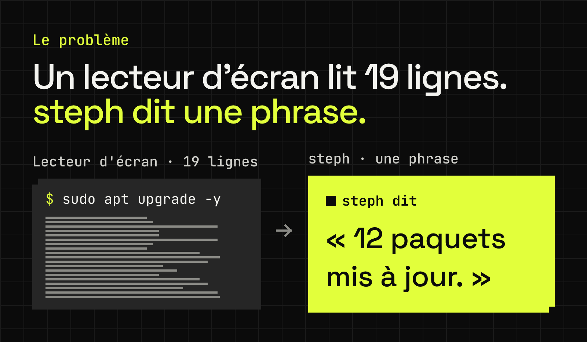
</picture>

Un lecteur d'écran lit tout, ligne après ligne : les 35 lignes de `lspci`, la
trace complète d'un build raté, chaque ligne d'une mise à jour. steph garde ce
qui compte et le dit en une phrase. La phrase de l'image est celle que steph dit
pour cette sortie : une règle écrite en code la construit, sans appel au modèle
(`docs/readme-charts/answers.small.json`, champ `said`).

## Ce que steph dit à voix haute

<picture>
  <source media="(prefers-color-scheme: dark)" srcset="assets/readme/says.fr.dark.png">
  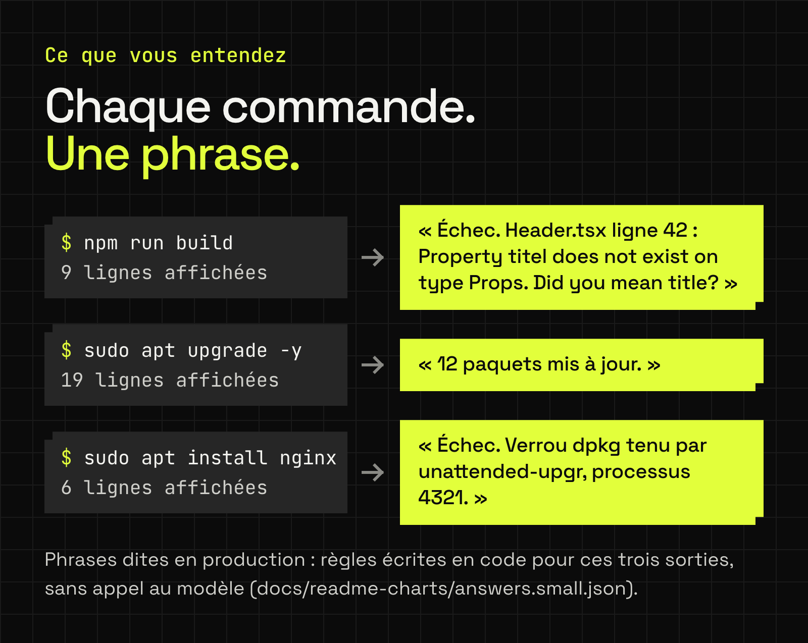
</picture>

- `ls /usr` → lit la sortie telle quelle (courte) ;
- `cat /nope` → « Erreur 1 : cat: /nope: Aucun fichier ou dossier de ce nom » ;
- `npm run build` qui échoue → « Échec. Header.tsx ligne 42 : Property titel does not exist on type Props. Did you mean title? » ;
- `apt upgrade` → « En cours : mise à jour des paquets. » … « 35 pour cent, décompression de vim-common. » … « Terminé en 1 minute 24. 12 paquets mis à jour. » ;
- une question `[O/n]` → « Question : il est nécessaire de prendre 24 Mo. Souhaitez-vous continuer ? oui ou non, oui par défaut » ;
- `ssh`, `python`, `psql`… → lit la réponse à chaque commande tapée dedans.

## Rien ne sort de la machine

<picture>
  <source media="(prefers-color-scheme: dark)" srcset="assets/readme/local.fr.dark.png">
  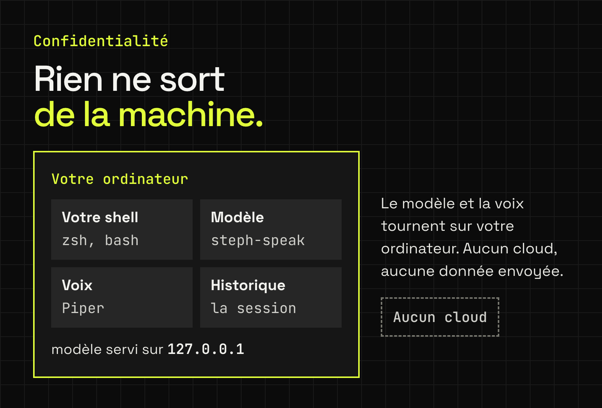
</picture>

Tout tourne **en local** : le modèle steph-speak (petit, ou base sur les machines plus rapides) via llama.cpp, et la synthèse vocale Piper. Le modèle et la voix ne quittent jamais la machine. **Aucune télémétrie** : ni dans le code de steph, ni dans les dépendances qu'il configure (la télémétrie d'onnxruntime, utilisée par la voix, est désactivée). Le seul réseau que steph utilise est celui que vous demandez : installer ou mettre à jour ([détails](docs/telemetry.md)). 4 Go de mémoire vidéo suffisent, et aucune n'est exigée : sur un portable i5 sans carte graphique, une question sur toute la session reçoit sa réponse en 2,2 s (médiane, petit modèle).

## Installation

<picture>
  <source media="(prefers-color-scheme: dark)" srcset="assets/readme/install.fr.dark.png">
  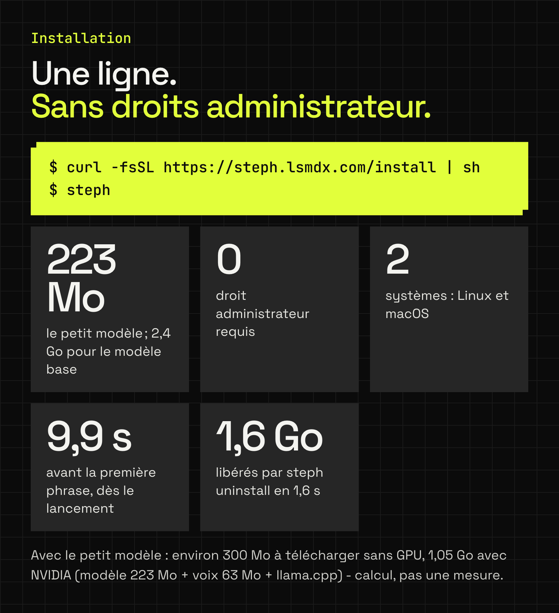
</picture>

```sh
curl -fsSL https://steph.lsmdx.com/install | sh
steph
```

Le petit modèle pèse 223 Mo, le modèle base 2,43 Go, plus la voix de 63 Mo et llama.cpp (version CUDA avec une carte NVIDIA). Le script
vérifie d'abord `curl`, `git`, la machine et la place libre, sans rien modifier en
cas d'échec. Il installe `uv` si besoin, sans toucher aux fichiers du shell, clone le
dépôt dans `~/.local/share/steph/src`, puis lance `scripts/install.sh`.

L'installation se lit au lecteur d'écran : une ligne de texte par étape, et tous
les 10 % pendant le modèle, avec la durée restante. La voix est installée en
premier : steph parle avant le modèle, ce qui prouve que le son fonctionne.

Si `steph` n'est pas trouvé à la fin, le script donne son chemin complet et la
ligne à ajouter au shell. Pour tout retirer : `steph uninstall`
(`--keep-models` garde les modèles).

Ou à la main :

```sh
git clone https://github.com/tutozz/steph && cd steph
./scripts/install.sh      # voix + commande steph + llama.cpp + modèle
steph                     # lance le terminal parlant
```

Prérequis à la main : `uv` ([installation](https://docs.astral.sh/uv/)). La ligne unique l'installe seule. Sur un Linux plus ancien que Debian 13 ou Ubuntu 24.04 (glibc inférieure à 2.38), le llama.cpp précompilé ne démarre pas : l'installeur le construit alors, ce qui demande `cmake` et un compilateur C++.

### Matériel

<picture>
  <source media="(prefers-color-scheme: dark)" srcset="assets/readme/hardware.fr.dark.png">
  
</picture>

**Linux** : PipeWire ou PulseAudio (`paplay`). Une carte NVIDIA est utilisée si
elle est présente (4 Go suffisent), sinon Vulkan, sinon CPU.

**macOS** (Apple Silicon ou Intel) :

```sh
brew install uv llama.cpp sox   # sox : voix plus réactive (sinon afplay, intégré)
./scripts/install.sh
steph
```

- Le modèle tourne sur le GPU via Metal (llama.cpp de Homebrew, ou le binaire
  officiel si Homebrew est absent).
- Sur Mac, les touches F6 à F10 sont des touches multimédia : il faut appuyer
  sur **fn** en même temps, ou activer « Utiliser F1, F2… comme touches de
  fonction standard » (Réglages → Clavier). On peut aussi choisir d'autres
  touches dans `config.toml`.
- La fenêtre de questions (F7) s'ouvre dans Terminal.app, ou dans iTerm si
  `steph` tourne dans iTerm.
- Si Piper n'est pas disponible, `steph` se rabat sur la voix système `say`
  (voix « Thomas », à changer avec `STEPH_MAC_VOICE`).
- Détection des questions : `ps -o wchan` (état `ttyin`) remplace `/proc`.

## Touches et commandes

<picture>
  <source media="(prefers-color-scheme: dark)" srcset="assets/readme/keys.fr.dark.png">
  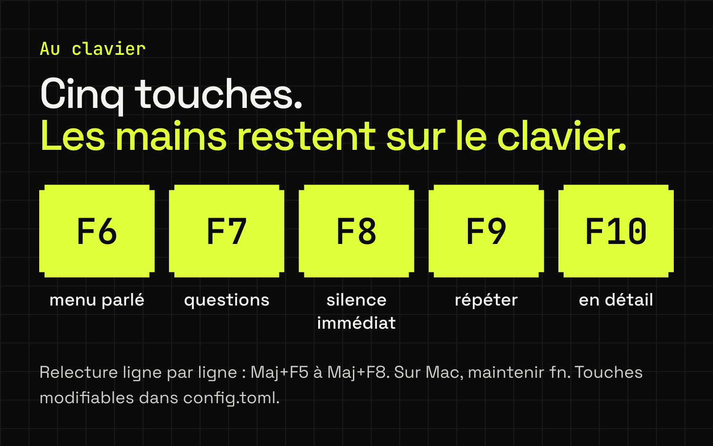
</picture>

| Touche / commande | Effet |
|---|---|
| **F6** | ouvre le menu parlé (réglages, actions, aide des touches) ; Échap ou F6 le ferme |
| **F7** | ouvre la fenêtre de questions (2e terminal) |
| **F8** | silence immédiat |
| **F9** | répète la dernière annonce |
| **F10** | explication détaillée de la dernière commande |
| **Maj+F5** / **Maj+F8** | relecture : première / dernière ligne de la dernière sortie |
| **Maj+F6** / **Maj+F7** | relecture : ligne précédente / suivante (« Début. », « Fin. » aux bornes) |
| `q pourquoi ça a planté ?` | question rapide, sans quitter le shell |
| `q` puis Entrée | pose la question à une invite `?` : apostrophes et guillemets sans échappement |
| `steph ask` | fenêtre de questions (dans n'importe quel terminal) |
| `steph ctl stop\|repeat\|details\|prev\|next\|first\|last\|status\|history` | contrôle à distance de la session |
| `steph say "texte"` | tester la voix |
| `steph server status\|stop` | le modèle local |

### Poser une question sur la session

<picture>
  <source media="(prefers-color-scheme: dark)" srcset="assets/readme/ask.fr.dark.png">
  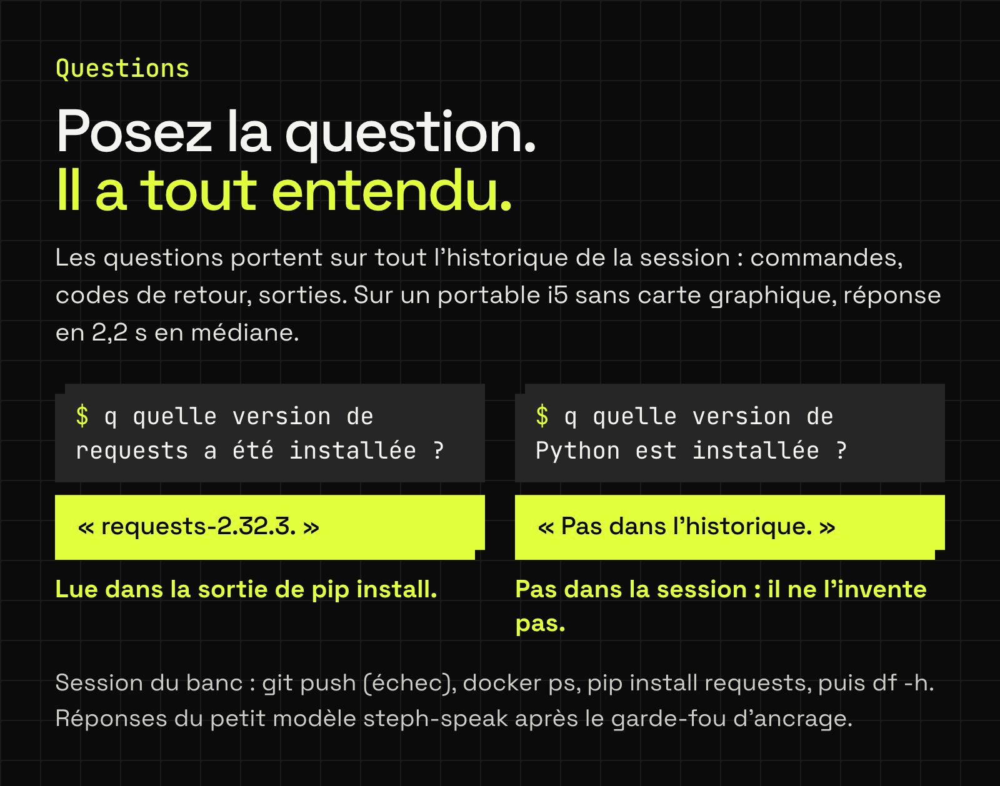
</picture>

Les questions portent sur **tout l'historique de la session** : commandes,
codes de retour et sorties. Pas besoin de recopier quoi que ce soit. Quand la
réponse n'est pas dans la session, steph le dit au lieu de deviner.

## Comment ça marche

<picture>
  <source media="(prefers-color-scheme: dark)" srcset="assets/readme/how.fr.dark.png">
  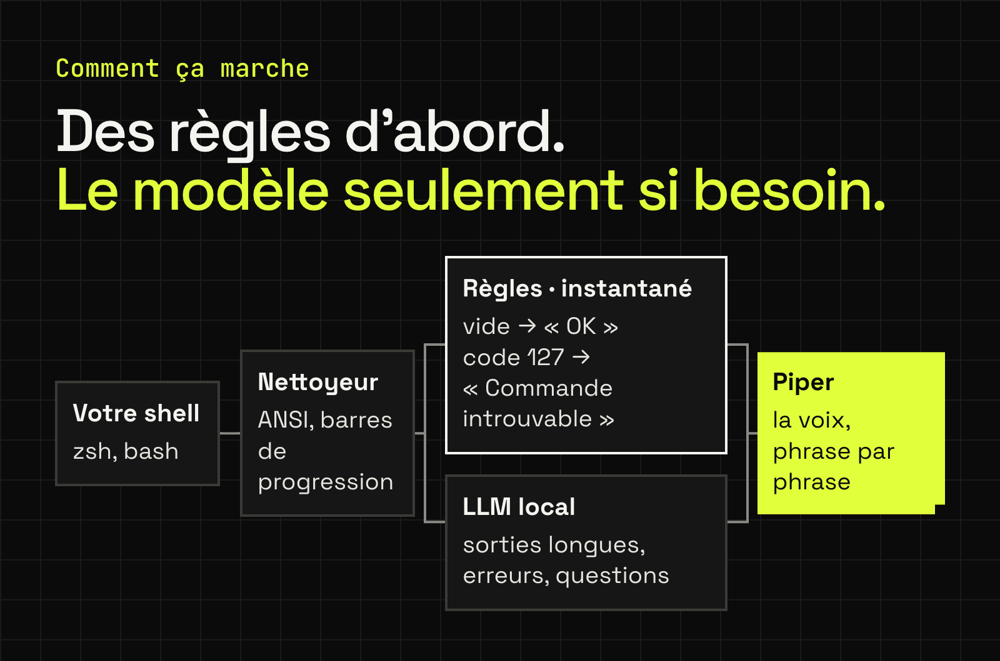
</picture>

```
clavier ──► proxy PTY ──► ton shell (zsh/bash + marqueurs)
                │  ▲
   sortie ◄─────┘  │ marqueurs invisibles : début de commande, fin + code de retour
                ▼
          nettoyeur (ANSI, \r, barres de progression, ligne de statut d'apt)
                ▼
          narrateur ── règles déterministes (instantané) ──┐
                │                                          ├──► Piper ──► haut-parleur
                └── LLM local (résumés, étapes, Q&R) ──────┘
```

- **Déterministe d'abord.** Sortie vide → « OK » ; sortie courte → lue telle
  quelle ; `cd` → « Dossier tmp » ; code 127 → « Commande introuvable » ;
  pourcentages et étapes connues (apt, dnf, pip, git, docker, cargo, make…)
  extraits par expressions régulières. Environ 61 % de ce que dit steph
  aujourd'hui ne demande ainsi aucun appel au modèle (ce chiffre est peut-être
  optimiste, voir le journal de mission interne (non publié) ; 40,5 % sur le jeu de test du banc v3) ; le LLM ne sert que pour
  résumer une sortie longue ou expliquer une erreur.
- **Rien d'inventé, autant que possible.** Chaque nombre, nom ou chemin dit
  par le modèle est vérifié contre l'entrée réelle ; ce qui n'y figure pas est
  coupé avant la voix. Sur le petit modèle précédent (v1.0), les inventions confirmées passent
  de 4,0 à 3,7 sur 36 avec ce garde-fou (non remesuré sur le modèle actuel) ; un défaut connu peut encore signaler à tort un mot
  correct.
- **Parler tôt.** La réponse du LLM est lue phrase par phrase pendant qu'elle
  se génère. Pour une commande longue, « Terminé en 32 secondes » est dit
  immédiatement pendant que le résumé se calcule.
- **Savoir quand le programme attend l'utilisateur.** `steph` regarde dans
  `/proc/<pid>/syscall` si le programme au premier plan est bloqué en lecture
  sur le terminal. Il distingue ainsi une vraie question d'une commande tapée
  à l'avance.
- **Questions rapides grâce au cache.** L'historique est construit en « ajout
  seul » et pré-calculé pendant que le GPU est libre (préchauffage annulable).
  Une question ne coûte donc que le calcul de ses propres mots.
- **Robuste.** Si le modèle tombe, `steph` le relance et utilise un résumé
  déterministe en attendant.
- **Une seule voix, sans chevauchement.** Un service vocal unique est partagé
  entre toutes les fenêtres ouvertes ; la fenêtre au premier plan parle
  d'abord, les autres attendent dans une file nommée. Mesuré sur 8 fenêtres :
  le chevauchement de parole passe de 79 % à 0 %, la RAM de 1 535 Mo à 530 Mo
  (le journal de mission interne (non publié)).
- **Libère la mémoire au repos.** Le modèle local se décharge après 10 minutes
  sans requête (réglable) et se recharge dès la première frappe d'une
  commande : il est généralement prêt avant même la fin de la commande.

## Voix et prononciation

<picture>
  <source media="(prefers-color-scheme: dark)" srcset="assets/readme/voice.fr.dark.png">
  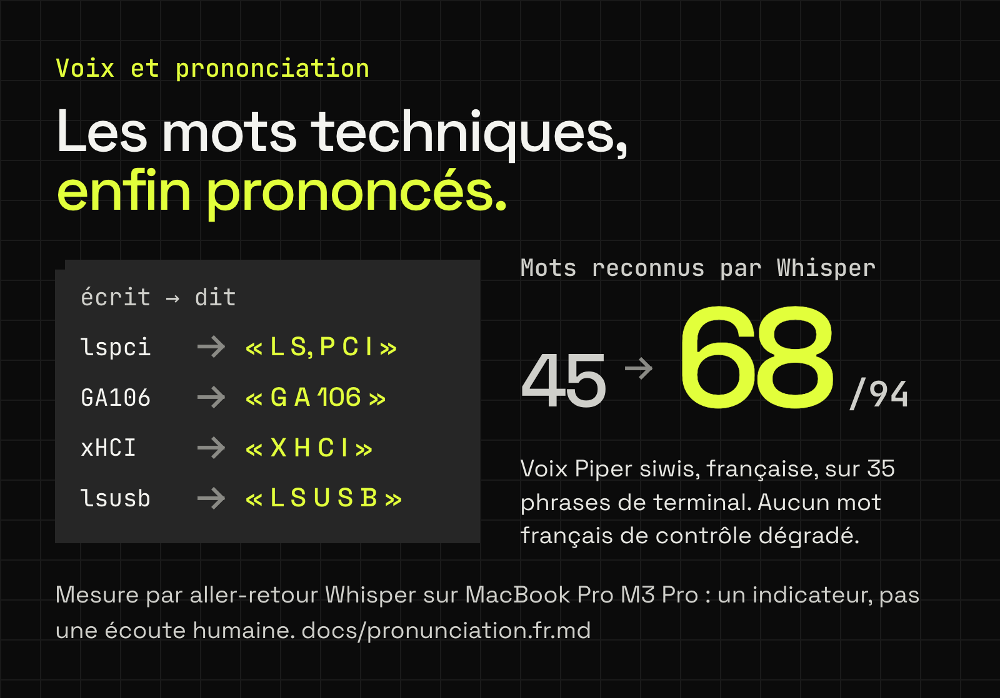
</picture>

La voix est Piper `fr_FR-siwis-medium`, en français. Avant de parler, steph
réécrit ce qu'une voix française écorcherait : les sigles sont épelés, les noms
de modèle comme `GA106` sont séparés, les commandes comme `lspci` deviennent
des lettres.

- Mesure par aller-retour Whisper sur 35 phrases de terminal : 45/94 mots cibles
  reconnus avant, 68/94 après. Aucun mot français de contrôle dégradé.
- Whisper est un indicateur d'intelligibilité, pas une écoute humaine. Méthode
  et tableau par mot : [docs/pronunciation.fr.md](docs/pronunciation.fr.md).
- Débit et voix : `speech_rate` et `voice` dans `config.toml`.

## Modèles bruts comparés (mesures sur NVIDIA T600 4 Go)

<picture>
  <source media="(prefers-color-scheme: dark)" srcset="assets/readme/bench.fr.dark.png">
  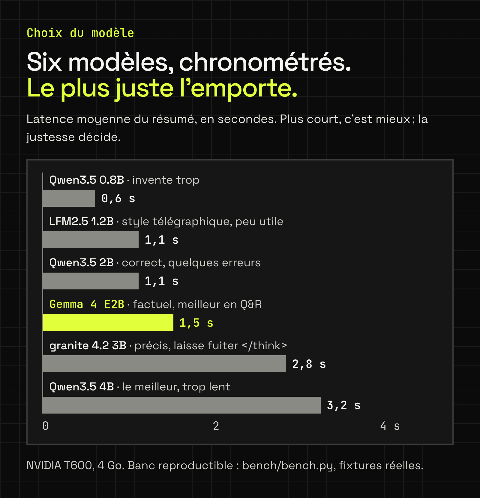
</picture>

| Modèle | Latence moyenne d'un résumé | Qualité |
|---|---|---|
| Qwen3.5 0.8B | 0,6 s | invente trop |
| LFM2.5 1.2B | 1,1 s | style télégraphique, peu utile |
| Qwen3.5 2B | 1,1 s | correct, quelques erreurs |
| **Gemma 4 E2B** (la base de steph-speak base) | 1,5 s | factuel, meilleur en Q&R |
| granite 4.2 3B | 2,8 s | précis, laisse fuiter `</think>` |
| Qwen3.5 4B | 3,2 s | le meilleur, trop lent |

Benchmark reproductible : `bench/bench.py` (fixtures réelles dans `bench/`).

## Deux modèles de voix, un par machine

<picture>
  <source media="(prefers-color-scheme: dark)" srcset="assets/charts/hero.fr.dark.png">
  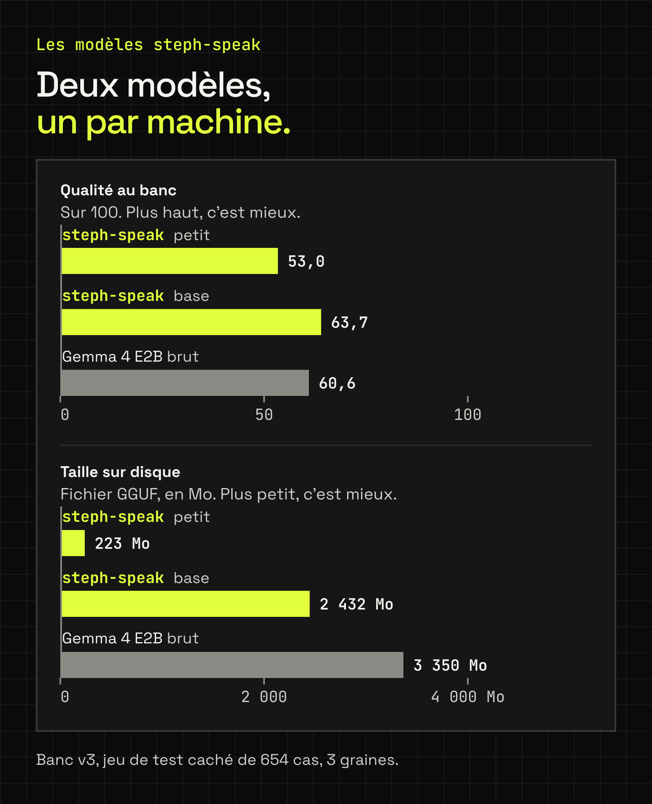
</picture>

steph transforme un mur de sortie de terminal en une phrase dite à voix haute. Il livre deux modèles, tous deux affinés sur de vraies sessions de terminal et tous deux exécutés en local avec llama.cpp.

| Modèle | Pour | Taille | Premier mot, portable i5 | Mémoire |
|---|---|---|---|---|
| [steph-speak petit](https://huggingface.co/lsmdx/steph-speak-granite-4.0-h-350M-v2-GGUF) (Granite 4.0 H 350M) | tout portable, avec ou sans GPU | 223 Mo | 2,33 s (9 fois sur 10) | 564 Mo |
| [steph-speak base](https://huggingface.co/lsmdx/steph-speak-gemma-4-E2B-v2-GGUF) (Gemma 4 E2B) | machines qui lisent vite un prompt : `steph setup` mesure la vôtre et choisit | 2,43 Go | 27,2 s | 3,9 Go |

La qualité se mesure sur le jeu de test caché du Steph Speak Bench v3 (654 cas, 3 graines, juge Qwen3.5 9B pour les inventions). Le petit modèle obtient 53,0 et invente dans 26,0 % des réponses. Le modèle base, dans son fichier publié, obtient 63,7 contre 60,6 pour Gemma 4 E2B brut et invente dans 19,1 % des réponses (brut : 18,2 %). Comparaisons appariées : la version Q4_0 complète bat Gemma brut de +3,45 (intervalle à 95 % de +1,98 à +4,91), sans écart significatif d'inventions, et le fichier publié, plus petit, s'en écarte de -0,37 en qualité et de +1,07 point d'inventions, sans significativité.

<picture>
  <source media="(prefers-color-scheme: dark)" srcset="assets/charts/quality.fr.dark.png">
  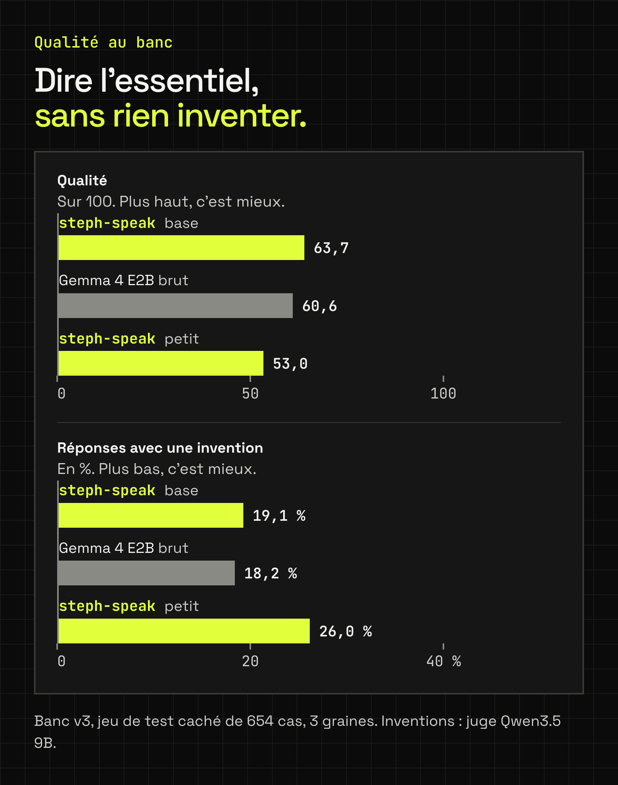
</picture>

La cible : un portable Intel Core i5-7200U, 2 cœurs, sans GPU. Là, le petit modèle dit son premier mot en 2,33 s neuf fois sur dix, quand un modèle brut de 2B met 13,3 s. Les modèles bruts du graphique de vitesse ont été mesurés avec un prompt plus simple que celui de production de steph : lisez leurs barres comme un ordre de grandeur.

<picture>
  <source media="(prefers-color-scheme: dark)" srcset="assets/charts/speed.fr.dark.png">
  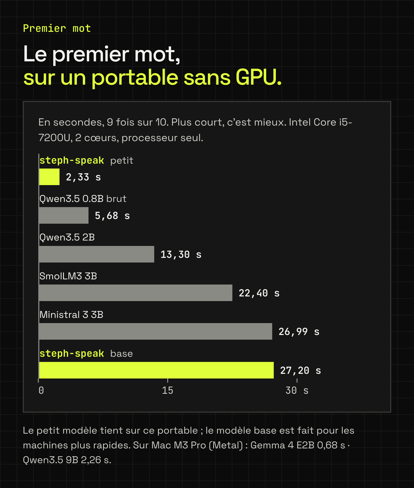
</picture>

<picture>
  <source media="(prefers-color-scheme: dark)" srcset="assets/charts/size.fr.dark.png">
  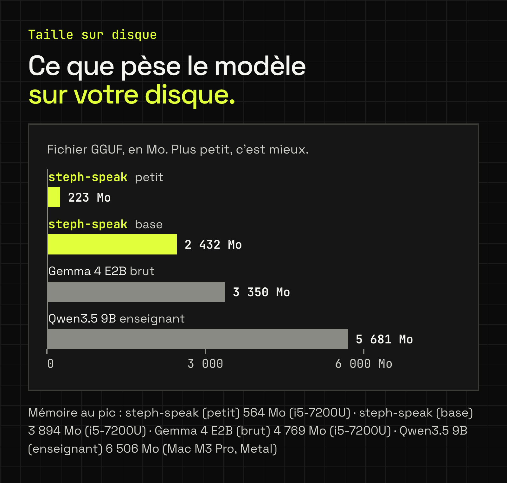
</picture>

<picture>
  <source media="(prefers-color-scheme: dark)" srcset="assets/charts/example.fr.dark.png">
  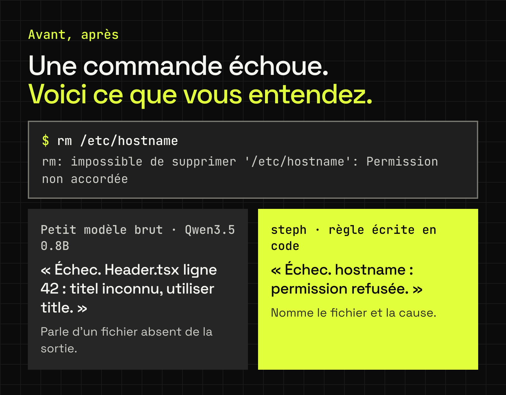
</picture>

La phrase steph-speak ci-dessus est celle du petit modèle seul, sans les règles écrites en code. En production, cette sortie n'atteint jamais le modèle : une règle écrite en code dit « Échec. hostname : permission refusée. » Sur un Mac M3 Pro, la mesure finale place `llama-server` à 448 Mo au lieu de 3 577 Mo avec l'ancien modèle par défaut, et 8 fenêtres de terminal à 963 Mo au total au lieu de 5 181 Mo (le journal de mission interne (non publié), mesuré avec un modèle de même taille et de même architecture que le petit).

**Comment on l'a fait.** De vraies sorties de terminal recueillies sur des machines du labo, anonymisées et auditées avant tout usage ; chacune étiquetée surtout par Qwen3.5 27B, le reste par Qwen3.5 9B (distillation) ; un affinage LoRA d'un petit modèle de base ; un export GGUF pour llama.cpp. Méthode complète, seuils et fichiers du banc : [bench/matrix/](bench/matrix/).

**Langues.** steph répond en français ou en anglais ; la voix reste française pour l'instant. Sur le jeu de test du Steph Speak Bench (prompt de production de steph), le petit modèle obtient 41,5 % en français et 48,3 % en anglais (protocole différent, non comparable aux barres de qualité ci-dessus). Les sorties en allemand, espagnol, portugais et russe sont lues, mais les réponses dans ces langues ne sont pas encore fiables : le journal de mission interne (non publié)).

**Téléchargement.** [steph-speak petit](https://huggingface.co/lsmdx/steph-speak-granite-4.0-h-350M-v2-GGUF) et [steph-speak base](https://huggingface.co/lsmdx/steph-speak-gemma-4-E2B-v2-GGUF) sur Hugging Face (compte `lsmdx`), ou automatiquement par le script d'installation.

## Configuration

Voir `config.example.toml` → `~/.config/steph/config.toml`.

Règles par commande, dans une table `[rules]` (clé = premier mot de la commande) :

```toml
[rules]
watch = "mute"      # rien n'est dit, sauf une erreur
top = "mute-all"    # rien n'est dit, même une erreur
cat = "verbatim"    # sortie lue en entier, quelle que soit sa longueur
make = "summary"    # toujours un résumé par le LLM
```

Les réglages de `llama-server` (parallélisme, batch, flash attention, type de
cache…) s'adaptent automatiquement au GPU détecté : `steph profile` affiche le
matériel détecté et la commande qui serait lancée. Détail et contribution
d'un profil pour une carte non reconnue : `src/steph/profiles/README.md`.

## Tests

La CI GitHub Actions (`.github/workflows/ci.yml`) lance les tests sur Ubuntu
et macOS, avec zsh et bash (le bash 3.2 de macOS compris), ainsi qu'un test
de bout en bout du LLM sur Mac avec llama.cpp de Homebrew.

```sh
uv run pytest tests               # unitaires (nettoyeur, marqueurs, étapes)
uv run python tests/e2e.py basic  # bout en bout, voix coupée, journal de parole
#   scénarios : basic long prompt repl subshell ask keys real typeahead
```

Journal : `$XDG_RUNTIME_DIR/steph/steph.log` et `llama-server.log`.

## Limites connues

- Les applications plein écran (vim, htop, less) ne sont pas lues : `steph`
  annonce seulement qu'elles sont ouvertes.
- La touche Entrée tapée à l'avance est bien gérée, mais pas les flèches dans
  une ligne en cours d'édition, dont le filtrage reste approximatif.
- Le petit modèle se trompe parfois dans les comptes, par exemple « 50 nombres »
  au lieu de 60. F10 et les questions donnent plus de détails.

## Licence

<picture>
  <source media="(prefers-color-scheme: dark)" srcset="assets/readme/license.fr.dark.png">
  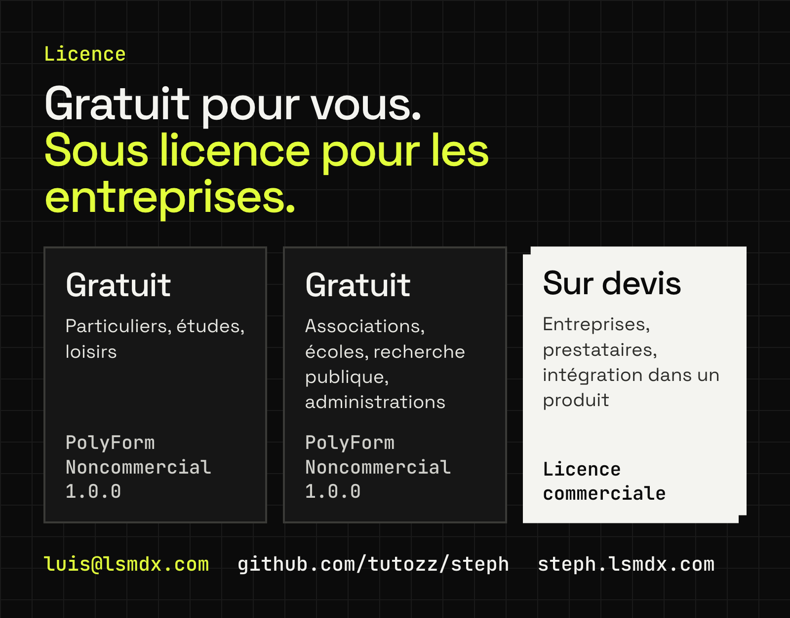
</picture>

| Usage | Licence | Prix |
|---|---|---|
| Particuliers, études, loisirs | [PolyForm Noncommercial 1.0.0](LICENSE.md) | gratuit |
| Associations, écoles, recherche publique, administrations | [PolyForm Noncommercial 1.0.0](LICENSE.md) | gratuit |
| Salarié qui utilise steph seul, sur son poste | [licence professionnelle individuelle](COMMERCIAL.md) | sur devis |
| Entreprises, prestataires, intégration dans un produit | [licence commerciale](COMMERCIAL.md) | sur devis |

Le code source est ouvert et modifiable. Tout usage commercial exige une
licence commerciale : écrire à [luis@lsmdx.com](mailto:luis@lsmdx.com).

## Soutenir

steph reste gratuit sous PolyForm Noncommercial pour les particuliers, quoi
qu'il arrive. Un café aide à payer les machines qui entraînent le petit
modèle steph-speak, les tests avec de vraies personnes aveugles et
malvoyantes, et le temps passé sur le projet.

[](https://buymeacoffee.com/lsmdx)

Icônes 3D du site : [Microsoft Fluent Emoji](https://github.com/microsoft/fluentui-emoji) (MIT).
