<!--
Draft to replace README.md. Image paths are relative to the repository root.
Images: python3 docs/readme-charts/build_readme.py (section images) and build.py (fine-tuned model charts).
-->

<p align="center">
  <a href="https://steph.lsmdx.com/en/">
    <picture>
      <source media="(prefers-color-scheme: dark)" srcset="assets/readme/banner.en.dark.png">
      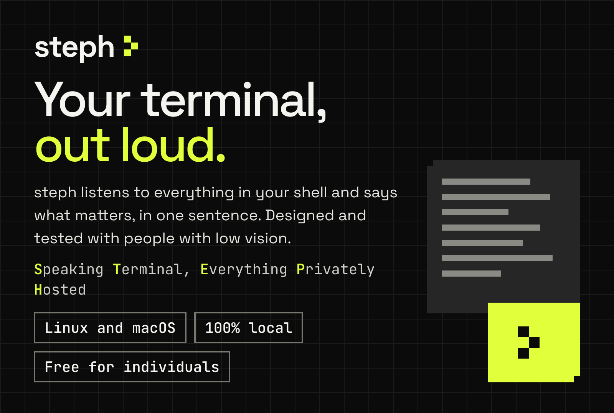
    </picture>
  </a>
</p>

<p align="center">
  <a href="LICENSE.md"></a>
  
  
  <a href="https://steph.lsmdx.com/en/"></a>
</p>

<p align="center"><strong>English</strong> · <a href="README.fr.md">Français</a></p>

<p align="center">
  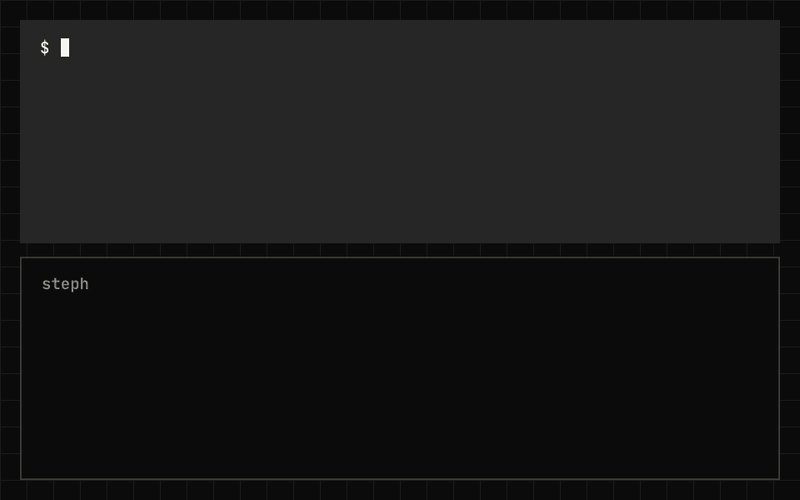<br>
  <sub>Real phrases from the delivered small model. <a href="assets/demo-en.mp4">Version with sound (mp4)</a>, English voice Piper en_US-lessac-medium.</sub>
</p>

# steph, the talking terminal

**S**peaking **T**erminal, **E**verything **P**rivately **H**osted.

> Your build fails. A screen reader reads you 40 lines of stack trace, one by one.
> steph says: *"Failed. Header.tsx line 42: Property titel does not exist on type Props. Did you mean title?"*

`steph` starts your shell (zsh or bash, with your usual configuration) and
listens to everything that goes through it. Instead of reading every line
aloud, it says **what matters, in one sentence**. Designed and tested with
visually impaired people.

> **September 2026**: steph speaks **French** today; an English voice is the next
> milestone. The examples below are translated. Source available: free for
> individuals, [licensed](COMMERCIAL.md) for companies.

Hear the voice: [steph.lsmdx.com](https://steph.lsmdx.com/en/).

## The problem

<picture>
  <source media="(prefers-color-scheme: dark)" srcset="assets/readme/problem.en.dark.png">
  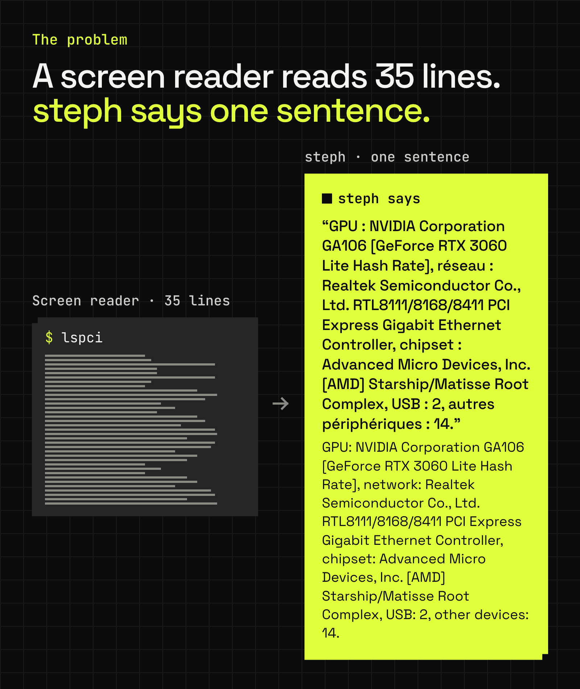
</picture>

A screen reader reads everything, line by line: the 35 lines of `lspci`, the
whole stack trace of a failed build, every line of an update. steph keeps what
matters and says it in one sentence. The sentence in the image is what steph says
for this output: a rule written in code builds it, without calling the model
(`docs/readme-charts/answers.small.json`, field `said`).

## What steph says out loud

<picture>
  <source media="(prefers-color-scheme: dark)" srcset="assets/readme/says.en.dark.png">
  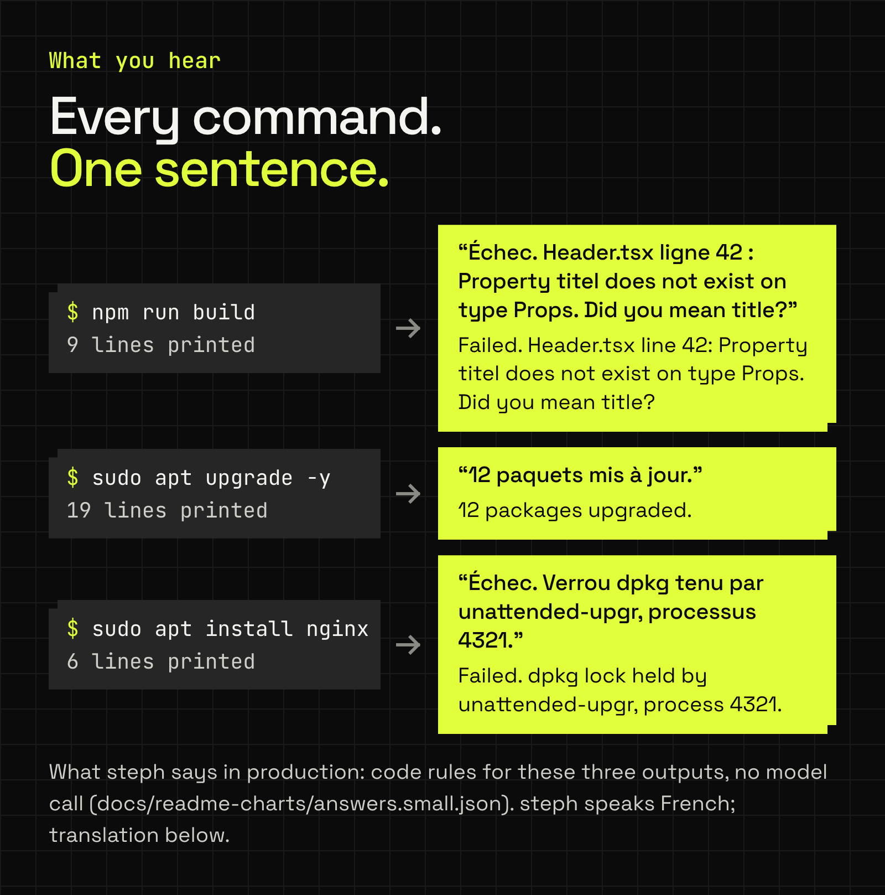
</picture>

- `ls /usr` → reads the output as is (it is short);
- `cat /nope` → "Error 1: cat: /nope: no such file or directory";
- a failing `npm run build` → "Failed. Header.tsx line 42: Property titel does not exist on type Props. Did you mean title?";
- `apt upgrade` → "Running: upgrading packages." … "35 percent, unpacking vim-common." … "Done in 1 minute 24. 12 packages upgraded.";
- a `[Y/n]` prompt → "Question: 24 MB of additional disk space will be used. Do you want to continue? yes or no, yes by default";
- `ssh`, `python`, `psql`… → reads the answer to each command typed inside.

## Nothing leaves your machine

<picture>
  <source media="(prefers-color-scheme: dark)" srcset="assets/readme/local.en.dark.png">
  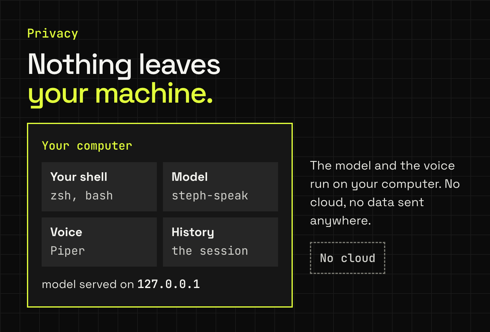
</picture>

Everything runs **locally**: the steph-speak model (small, or base on faster machines) through llama.cpp, and Piper speech synthesis. The model and the voice never leave the machine. **No telemetry**: not in steph's own code, not in the dependencies it configures (onnxruntime's telemetry, used by the voice, is disabled). The only network steph uses is the one you ask for: installing or updating ([details](docs/telemetry.md)). 4 GB of VRAM is enough, and none is required: on an i5 laptop with no graphics card, a question about the whole session is answered in 2.2 s (median, small model).

## Install

<picture>
  <source media="(prefers-color-scheme: dark)" srcset="assets/readme/install.en.dark.png">
  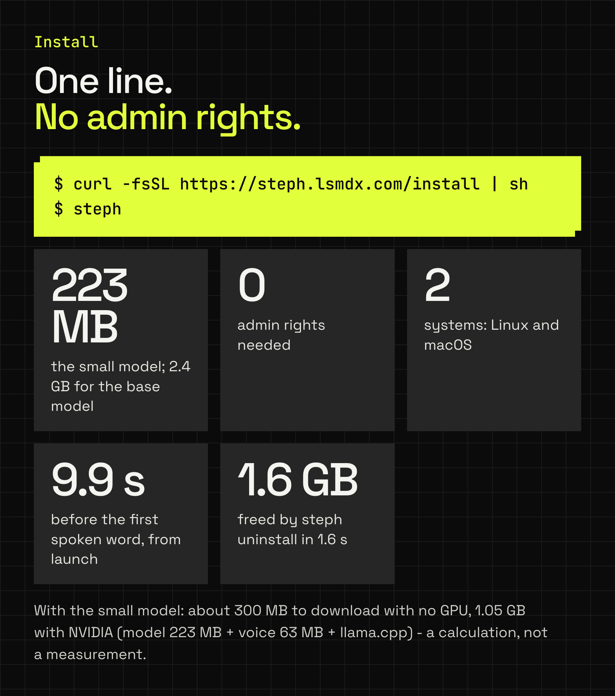
</picture>

```sh
curl -fsSL https://steph.lsmdx.com/install | sh
steph
```

The small model is 223 MB, the base model 2.43 GB, plus the 63 MB voice and llama.cpp (CUDA build with an NVIDIA card). The script
first checks `curl`, `git`, the machine and free space, and changes nothing if a
check fails. It installs `uv` if needed, without touching shell files, clones the
repository into `~/.local/share/steph/src`, then runs `scripts/install.sh`.

The installation reads well with a screen reader: one line of text per step, and
every 10 % during the model download, with the time left. The voice is installed
first: steph speaks before the model, which proves that sound works.

If `steph` is not found at the end, the script gives its full path and the line
to add to your shell. To remove everything: `steph uninstall`
(`--keep-models` keeps the models).

Or by hand:

```sh
git clone https://github.com/tutozz/steph && cd steph
./scripts/install.sh      # voice + steph command + llama.cpp + model
steph                     # start the talking terminal
```

Requirement by hand: `uv` ([install](https://docs.astral.sh/uv/)); the one-line install gets it for you. No admin rights needed.

### Hardware

<picture>
  <source media="(prefers-color-scheme: dark)" srcset="assets/readme/hardware.en.dark.png">
  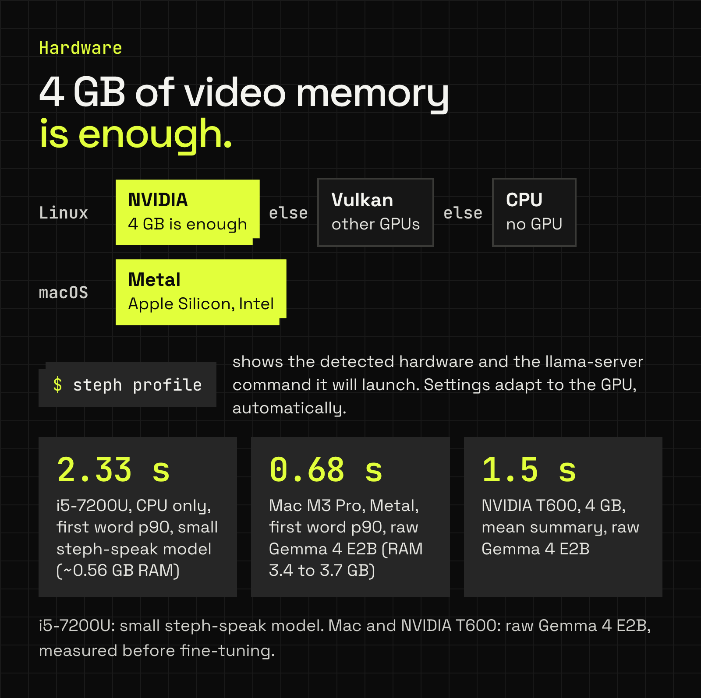
</picture>

**Linux**: PipeWire or PulseAudio (`paplay`). An NVIDIA card is used when
present (4 GB is enough), otherwise Vulkan, otherwise CPU.

**macOS** (Apple Silicon or Intel):

```sh
brew install uv llama.cpp sox   # sox: snappier voice (afplay otherwise, built in)
./scripts/install.sh
steph
```

- The model runs on the GPU through Metal (Homebrew llama.cpp, or the official
  binary when Homebrew is missing).
- On a Mac, F6 to F10 are media keys: hold **fn**, or turn on "Use F1, F2, etc.
  keys as standard function keys" (Settings → Keyboard). Other keys can be set
  in `config.toml`.
- The question window (F7) opens in Terminal.app, or in iTerm when `steph`
  runs in iTerm.
- Without Piper, `steph` falls back to the system `say` voice ("Thomas", change
  it with `STEPH_MAC_VOICE`).

## Keys and commands

<picture>
  <source media="(prefers-color-scheme: dark)" srcset="assets/readme/keys.en.dark.png">
  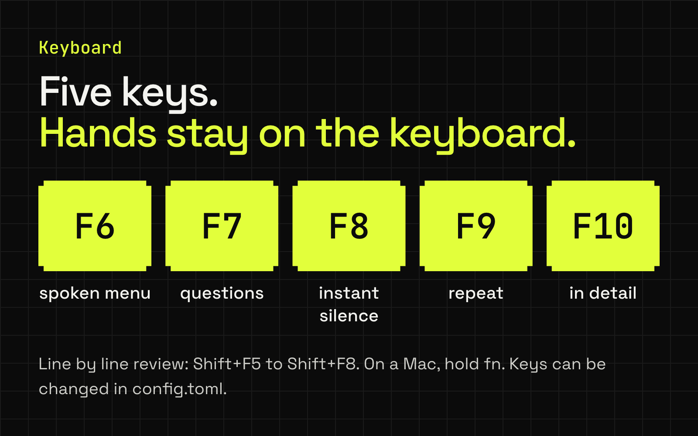
</picture>

| Key / command | Effect |
|---|---|
| **F6** | opens the spoken menu (settings, actions, keys help); Escape or F6 closes it |
| **F7** | opens the question window (second terminal) |
| **F8** | instant silence |
| **F9** | repeats the last announcement |
| **F10** | detailed explanation of the last command |
| **Shift+F5** / **Shift+F8** | review: first / last line of the last output |
| **Shift+F6** / **Shift+F7** | review: previous / next line ("Début.", "Fin." at the edges) |
| `q why did it crash?` | quick question, without leaving the shell |
| `q` then Enter | asks at a `?` prompt: quotes and apostrophes need no escaping |
| `steph ask` | question window (in any terminal) |
| `steph ctl stop\|repeat\|details\|prev\|next\|first\|last\|status\|history` | remote control of the session |
| `steph say "text"` | test the voice |
| `steph server status\|stop` | the local model |

### Ask about the session

<picture>
  <source media="(prefers-color-scheme: dark)" srcset="assets/readme/ask.en.dark.png">
  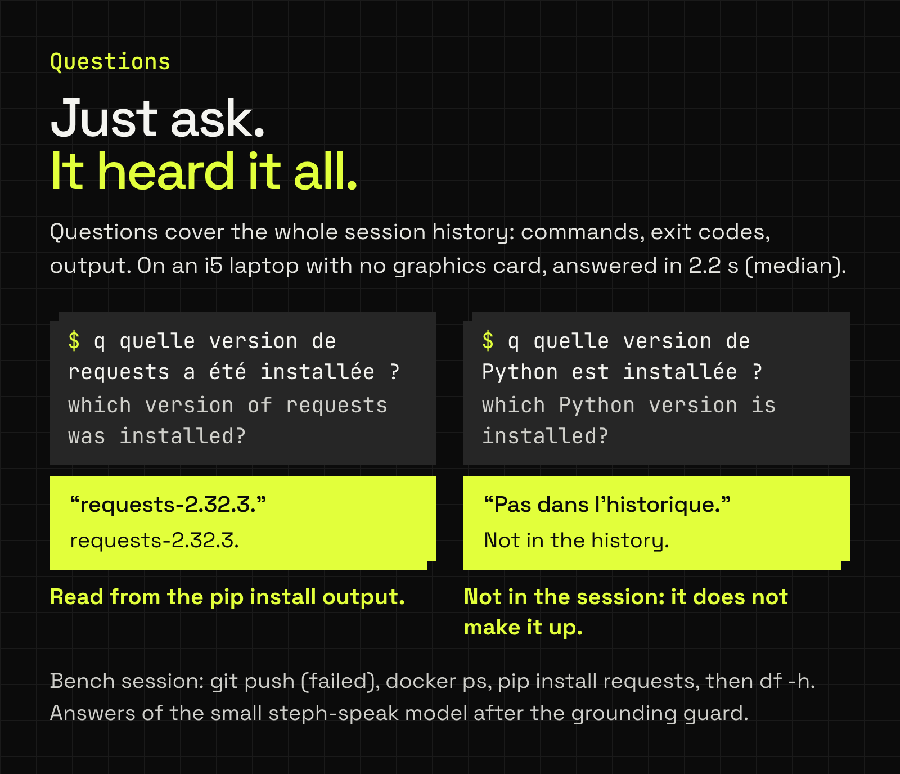
</picture>

Questions cover **the whole session history**: commands, exit codes and
output. No need to copy anything. When the answer is not in the session, steph
says so instead of guessing.

## How it works

<picture>
  <source media="(prefers-color-scheme: dark)" srcset="assets/readme/how.en.dark.png">
  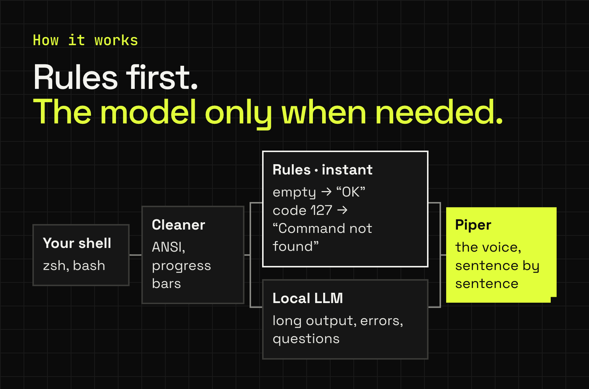
</picture>

```
keyboard ──► PTY proxy ──► your shell (zsh/bash + markers)
                │  ▲
   output ◄─────┘  │ invisible markers: command start, end + exit code
                ▼
          cleaner (ANSI, \r, progress bars, apt status line)
                ▼
          narrator ── deterministic rules (instant) ──┐
                │                                     ├──► Piper ──► speaker
                └── local LLM (summaries, steps, Q&A) ┘
```

- **Deterministic first.** Empty output → "OK"; short output → read as is;
  `cd` → "Folder tmp"; exit code 127 → "Command not found"; percentages and
  known steps (apt, dnf, pip, git, docker, cargo, make…) extracted with
  regular expressions. About 61% of what steph says today needs no model call
  at all this way (this share may be optimistic, see
  the internal mission log (not published); 40.5% on the v3 test set); the LLM only summarises long output or explains
  an error.
- **Nothing invented, when possible.** Every number, name or path the model
  states is checked against the real input; unsupported ones are cut before
  the voice. On the previous small model (v1.0), confirmed inventions drop from
  4.0 to 3.7 out of 36 with this guardrail (not re-measured on the current one); a known bug can still mis-flag a correct word.
- **Speak early.** The LLM answer is read sentence by sentence while it is
  generated. For a long command, "Done in 32 seconds" is said right away while
  the summary is computed.
- **Know when the program waits for you.** `steph` checks whether the
  foreground program is blocked reading the terminal. It tells a real prompt
  apart from a command typed ahead.
- **Fast questions thanks to the cache.** History is built append-only and
  pre-computed while the GPU is idle (cancellable warm-up). A question only
  costs its own words.
- **Robust.** If the model crashes, `steph` restarts it and uses a
  deterministic summary meanwhile.
- **One voice, no overlap.** A single voice service is shared by every open
  window; the foreground one speaks first, others wait in a named queue.
  Measured on 8 windows: overlapping speech goes from 79% to 0%, RAM from
  1,535 MB to 530 MB (the internal mission log (not published)).
- **Frees memory at rest.** The local model unloads after 10 minutes without a
  request (configurable) and reloads as soon as you start typing a command, so
  it is usually ready before the command even finishes.

## Voice and pronunciation

<picture>
  <source media="(prefers-color-scheme: dark)" srcset="assets/readme/voice.en.dark.png">
  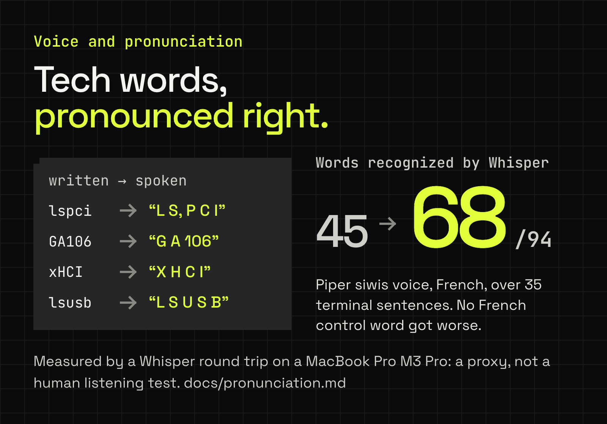
</picture>

The voice is Piper `fr_FR-siwis-medium`, in French. Before speaking, steph
rewrites what a French voice would mangle: acronyms are spelled out, model
names like `GA106` are split, commands like `lspci` become letters.

- Measured by a Whisper round trip over 35 terminal sentences: 45/94 target
  words recognized before, 68/94 after. No French control word got worse.
- Whisper is a proxy for intelligibility, not a human listening test. Method
  and per-word table: [docs/pronunciation.md](docs/pronunciation.md).
- Speed and voice: `speech_rate` and `voice` in `config.toml`.

## Raw models compared (measured on an NVIDIA T600, 4 GB)

<picture>
  <source media="(prefers-color-scheme: dark)" srcset="assets/readme/bench.en.dark.png">
  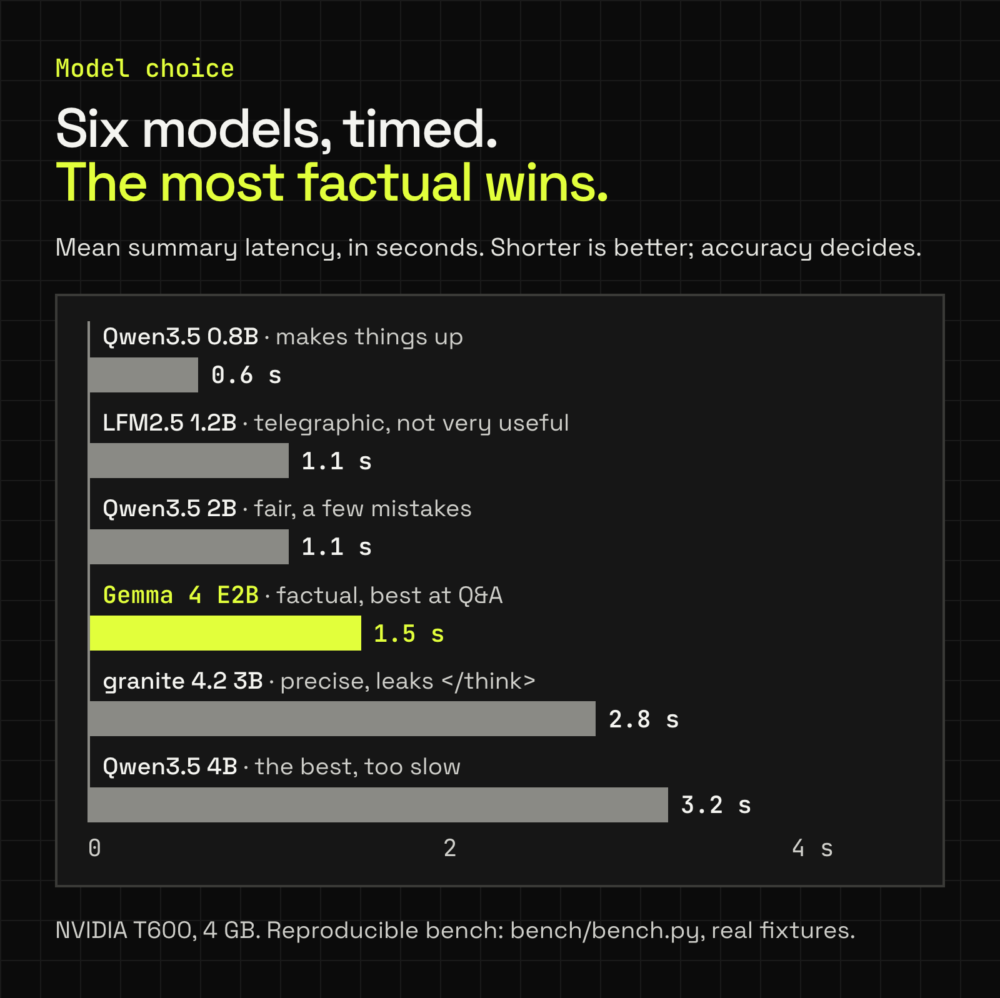
</picture>

| Model | Mean summary latency | Quality |
|---|---|---|
| Qwen3.5 0.8B | 0.6 s | makes things up |
| LFM2.5 1.2B | 1.1 s | telegraphic, not very useful |
| Qwen3.5 2B | 1.1 s | fair, a few mistakes |
| **Gemma 4 E2B** (the base of steph-speak base) | 1.5 s | factual, best at Q&A |
| granite 4.2 3B | 2.8 s | precise, leaks `</think>` |
| Qwen3.5 4B | 3.2 s | the best, too slow |

Reproducible benchmark: `bench/bench.py` (real fixtures in `bench/`).

## Two voice models, one per machine

<picture>
  <source media="(prefers-color-scheme: dark)" srcset="assets/charts/hero.en.dark.png">
  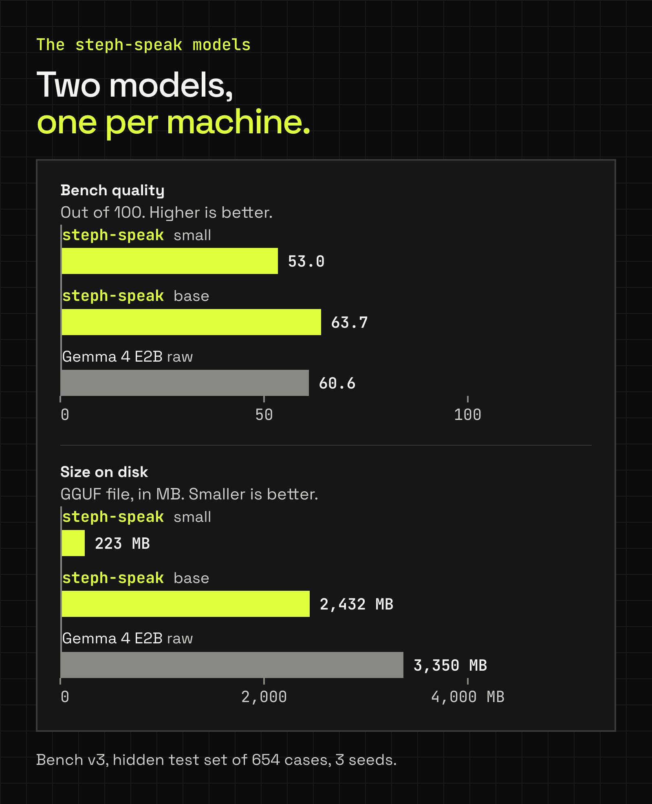
</picture>

steph turns a wall of terminal output into one spoken sentence. It ships two models, both fine-tuned on real terminal sessions and both run locally with llama.cpp.

| Model | For | Size | First word, i5 laptop | Memory |
|---|---|---|---|---|
| [steph-speak small](https://huggingface.co/tutozz/steph-speak-granite-4.0-h-350M-v2-GGUF) (Granite 4.0 H 350M) | any laptop, with or without a GPU | 223 MB | 2.33 s (9 times out of 10) | 564 MB |
| [steph-speak base](https://huggingface.co/tutozz/steph-speak-gemma-4-E2B-v2-GGUF) (Gemma 4 E2B) | machines that read a prompt fast: `steph setup` measures yours and picks | 2.43 GB | 27.2 s | 3.9 GB |

Quality is measured on the hidden test set of Steph Speak Bench v3 (654 cases, 3 seeds, judge Qwen3.5 9B for inventions). The small model scores 53.0 and invents in 26.0% of answers. The base model, in its released file, scores 63.7 against 60.6 for raw Gemma 4 E2B and invents in 19.1% of answers (raw: 18.2%). Paired comparisons: the full Q4_0 build beats raw Gemma by +3.45 (95% interval +1.98 to +4.91) with no significant difference in inventions, and the released smaller file differs from that build by -0.37 in quality and +1.07 points of inventions, neither significant.

<picture>
  <source media="(prefers-color-scheme: dark)" srcset="assets/charts/quality.en.dark.png">
  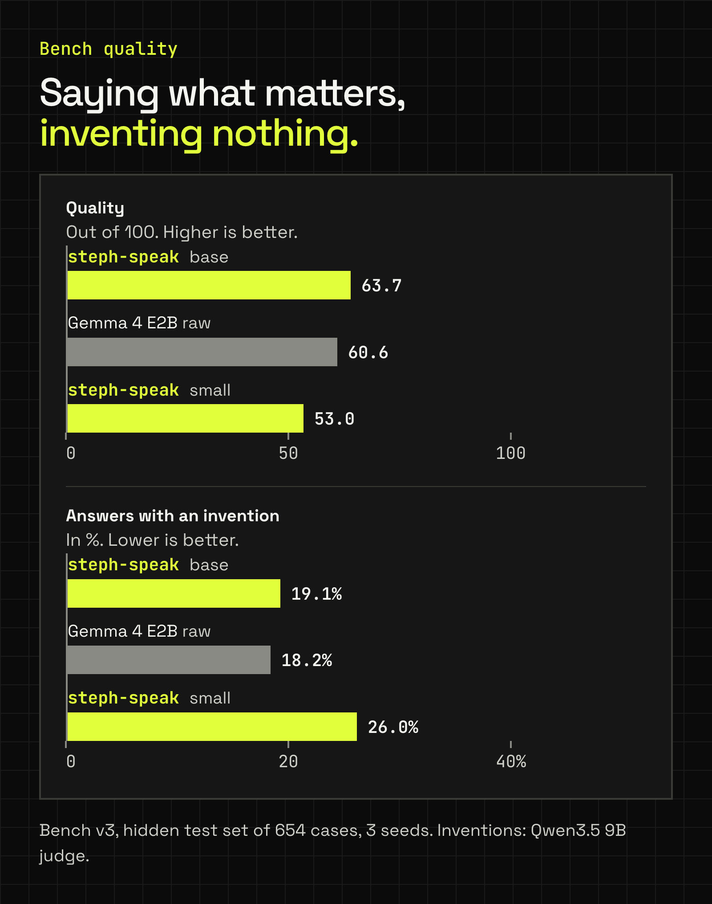
</picture>

The target machine is an Intel Core i5-7200U laptop from 2017: 2 cores, no GPU. There the small model speaks its first word within 2.33 s nine times out of ten, where a raw 2B model takes 13.3 s. The raw models of the speed chart were measured with a simpler prompt than steph's production prompt, so read their bars as an order of magnitude.

<picture>
  <source media="(prefers-color-scheme: dark)" srcset="assets/charts/speed.en.dark.png">
  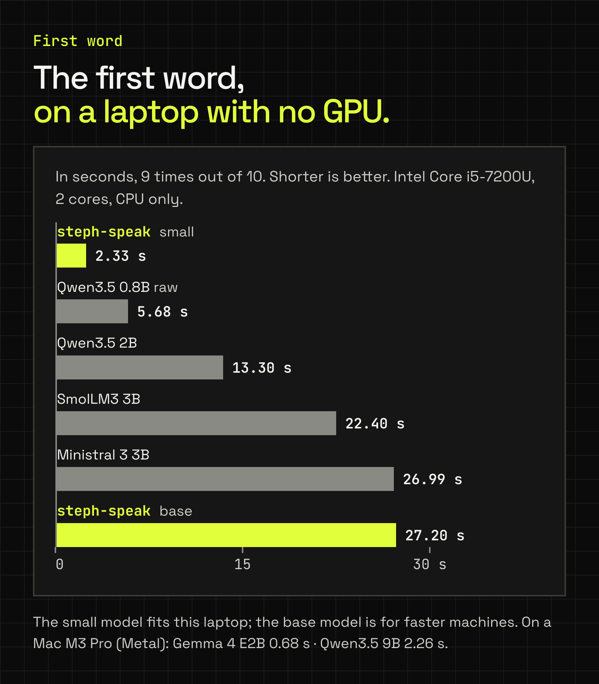
</picture>

<picture>
  <source media="(prefers-color-scheme: dark)" srcset="assets/charts/size.en.dark.png">
  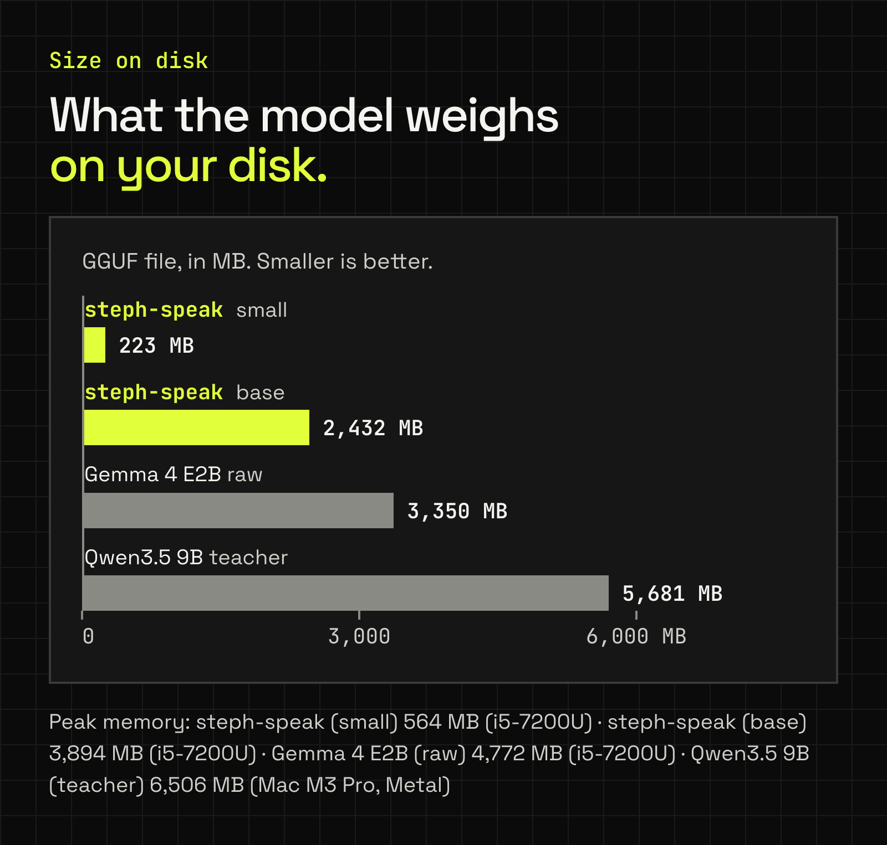
</picture>

<picture>
  <source media="(prefers-color-scheme: dark)" srcset="assets/charts/example.en.dark.png">
  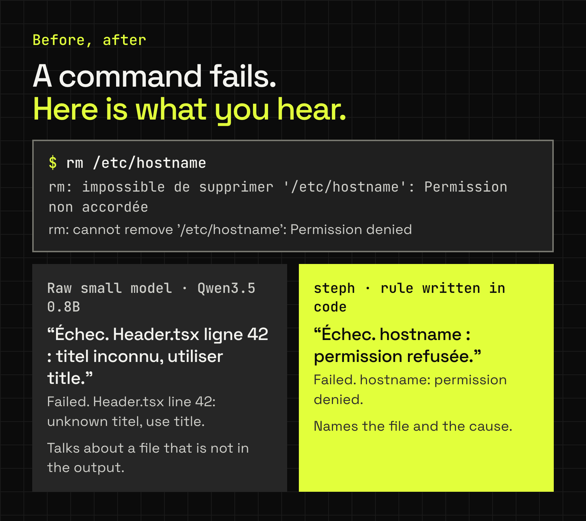
</picture>

The steph-speak sentence above is the small model alone, without steph's code rules. In production this output never reaches the model: a rule written in code says "Failed. hostname: permission denied." On a Mac M3 Pro, the final measure puts `llama-server` at 448 MB instead of 3,577 MB with the previous default model, and 8 terminal windows at 963 MB in total instead of 5,181 MB (the internal mission log (not published), measured with a model of the same size and architecture as the small one).

**How we built it.** Real terminal outputs collected on lab machines, anonymized and audited before any use; each one labeled mostly by Qwen3.5 27B, the rest by Qwen3.5 9B (distillation); a LoRA fine-tune of a small base model; exported to GGUF for llama.cpp. The full method, thresholds and bench files: [bench/matrix/](bench/matrix/).

**Languages.** steph answers in French or English; the voice is French for now. On the Steph Speak Bench test set (steph's own production prompt), the small model scores 41.5% in French and 48.3% in English (a different protocol, not comparable to the quality bars above). German, Spanish, Portuguese and Russian outputs are read, but the answers in those languages are not reliable yet: the internal mission log (not published)).

**Download.** [steph-speak small](https://huggingface.co/tutozz/steph-speak-granite-4.0-h-350M-v2-GGUF) and [steph-speak base](https://huggingface.co/tutozz/steph-speak-gemma-4-E2B-v2-GGUF) on Hugging Face (account `tutozz`), or automatically through the install script.

## Configuration

See `config.example.toml` → `~/.config/steph/config.toml`.

Per-command rules, in a `[rules]` table (key = first word of the command):

```toml
[rules]
watch = "mute"      # silent, except on error
top = "mute-all"    # silent, even on error
cat = "verbatim"    # output read in full, whatever its length
make = "summary"    # always an LLM summary
```

`llama-server` settings (parallelism, batch size, flash attention, cache
type…) auto-adapt to the detected GPU: run `steph profile` to see the
detected hardware and the command that would be launched. Details and how to
contribute a profile for an unrecognised card: `src/steph/profiles/README.md`
(in French).

## Tests

GitHub Actions (`.github/workflows/ci.yml`) runs the tests on Ubuntu and
macOS, with zsh and bash (including macOS bash 3.2), plus an end-to-end LLM
test on a Mac with Homebrew llama.cpp.

```sh
uv run pytest tests               # unit tests (cleaner, markers, steps)
uv run python tests/e2e.py basic  # end to end, voice muted, speech log
#   scenarios: basic long prompt repl subshell ask keys real typeahead
```

Logs: `$XDG_RUNTIME_DIR/steph/steph.log` and `llama-server.log`.

## Known limits

- Full-screen apps (vim, htop, less) are not read: `steph` only announces
  that they are open.
- Enter typed ahead is handled, but arrow keys inside a line being edited are
  only filtered approximately.
- The small model sometimes miscounts, for example "50 numbers" instead of 60.
  F10 and questions give more detail.

## License

<picture>
  <source media="(prefers-color-scheme: dark)" srcset="assets/readme/license.en.dark.png">
  
</picture>

| Use | License | Price |
|---|---|---|
| Individuals, study, hobby projects | [PolyForm Noncommercial 1.0.0](LICENSE.md) | free |
| Nonprofits, schools, public research, government | [PolyForm Noncommercial 1.0.0](LICENSE.md) | free |
| Employee using steph alone, on their own workstation | [individual professional license](COMMERCIAL.md) | quote on request |
| Companies, contractors, embedding in a product | [commercial license](COMMERCIAL.md) | quote on request |

The source code is open and can be modified. Any commercial use requires a
commercial license: write to [luis@lsmdx.com](mailto:luis@lsmdx.com).

## Support

steph stays free under PolyForm Noncommercial for individuals, whatever
happens next. A coffee helps pay for the machines that train the small
steph-speak model, testing with real blind and low vision people, and the
time spent on the project.

[](https://buymeacoffee.com/lsmdx)

3D icons on the website: [Microsoft Fluent Emoji](https://github.com/microsoft/fluentui-emoji) (MIT).
