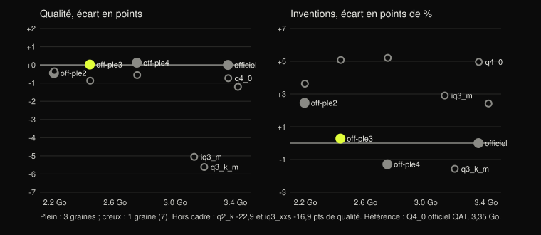

# G4 : variantes quantifiées de Gemma 4 E2B pour les machines de 8 Go

Date : 2026-09-29. Modèle de départ : le brut retenu en G3, Gemma 4 E2B QAT (`google/gemma-4-E2B-it-qat-q4_0-unquantized`, sha256 `33fe0cec…`). Rien sur le Mac : quantification sur l'hôte de la 3080 et sur celui de la 3060, banc sur la 3080, juge sur la 3060 et la 3080, vitesse sur l'i5.

## Décision

**Défaut 8 Go : `off-ple3`**, couches en Q4_0 sans imatrix (celles du Q4_0 officiel QAT) et plongements par couche (PLE) en Q3_K.

| Champ | Valeur |
|---|---|
| Fichier | `gemma-4-E2B-it-qat-Q4_0-ple-Q3_K.gguf`, 2 432 012 256 o (**2,43 Go** contre 3,35) |
| sha256 | `b47196ac569eb6cac032d121f9e2162f3102b17b7315a76ef3b44e3e94a7c4b8` |
| Chemin | hôte de la 3060 `/mnt/backup-hdd/stephbench-tmp/gemma/g4/final/` ; même fichier sur l'i5 `/root/g4/gguf/off-ple3.gguf` |
| Recette | `llama-quantize --tensor-type per_layer_token_embd=q3_k <bf16 QAT> <sortie> Q4_0` (b11205, sans imatrix) |
| Qualité, 3 graines | **60,5 contre 60,5**, écart +0,02 [-0,76 ; +0,77] |
| Inventions, 3 graines | **20,0 % contre 19,7 %**, écart +0,28 [-1,37 ; +1,90] |
| RAM pic `llama-server`, i5 | **3 888 Mo contre 4 769 Mo** (-881 Mo) |
| 1er jeton i5, médiane / p90 | 13,9 / **27,5 s** contre 14,3 / 28,7 s |

- **Même comportement que l'officiel, 0,92 Go de moins.** Aucun axe ne bouge de façon significative. La mauvaise langue sous prompt EN monte de 0,97 pt, IC [0,00 ; +2,10], à la limite.
- **RAM totale steph : environ 4,1 Go**, soit 3 888 Mo de `llama-server` plus 208-224 Mo de steph et Piper (Q1). Un peu au-dessus de la cible de ~4 Go.
- **`off-ple2` tient sous 4 Go** (3 664 Mo, 2,19 Go de fichier) mais **invente plus : +2,46 pts [+0,52 ; +4,44]**, 22,2 %. Rejeté.
- **`off-ple4`** (2,74 Go) est le plus sûr : qualité +0,12, inventions -1,29 [-2,70 ; +0,08]. Il garde 300 Mo de plus que `off-ple3` pour un gain non significatif.
- **Premier son** : inchangé par construction (phrase d'attente et aides D5 en code, indépendants du modèle ; G2 : 0,00-0,01 s). Non remesuré.
- **Premier fait p90** : 27,5 s, le plus bas des variantes sans perte de qualité, à 0,2 s près de `off-ple2` et `off-ple4`. Le PLE ne coûte rien en calcul (lu par index) ; la quantification n'est pas le levier de vitesse (voir Vitesse).

## Pourquoi le PLE

| Tenseur (Q4_0 officiel) | Type | Taille | Part |
|---|---|---|---|
| `per_layer_token_embd` (PLE, 2,35 G paramètres) | Q6_K | 1 927 Mo | **58 %** |
| `token_embd` (lié à la sortie) | Q6_K | 330 Mo | 10 % |
| 35 couches (attention, FFN) | Q4_0 | 1 045 Mo | 31 % |

- Les types classiques (Q3_K_M, IQ3_M, Q2_K) ne touchent que les couches : 160 à 370 Mo gagnés, 5 à 23 pts de qualité perdus. IQ3_XXS gagne 700 Mo parce qu'il passe aussi le PLE en Q5_K, mais perd 17 pts.
- Le PLE n'est lu que par index, une ligne par jeton : le descendre coûte peu en qualité et libère jusqu'à 1,16 Go.
- `token_embd` est aussi la tête de sortie : laissé en Q6_K.

## Courbe

## Tableau

Banc v3 **test** (654 cas, 1 308 évaluations FR + EN). Écarts appariés par cas contre le Q4_0 officiel sur les graines communes, bootstrap 10 000 tirages. Inventions : juge A7 sur les réponses `reaches_model`. En gras : écart significatif.

| Variante | Couches | PLE | Taille | Graines | Qualité | Écart qualité | Inventions | Écart inventions | Mauvaise langue EN |
|---|---|---|---|---|---|---|---|---|---|
| Q4_0 officiel (référence) | Q4_0 QAT | Q6_K | 3,35 Go | 3 | 60,5 | - | 19,7 % | - | 3,6 % |
| `off-ple4` | Q4_0 QAT | Q4_0 | 2,74 Go | 3 | 60,6 | +0,12 [-0,57 ; +0,80] | 18,4 % | -1,29 [-2,70 ; +0,08] | 3,6 % |
| **`off-ple3`** | Q4_0 QAT | Q3_K | **2,43 Go** | 3 | 60,5 | +0,02 [-0,76 ; +0,77] | 20,0 % | +0,28 [-1,37 ; +1,90] | 4,6 % |
| `off-ple2` | Q4_0 QAT | Q2_K | 2,19 Go | 3 | 60,0 | -0,45 [-1,46 ; +0,52] | 22,2 % | **+2,46 [+0,52 ; +4,44]** | 4,2 % |
| `q4_0` imatrix | Q4_0 imatrix | Q6_K | 3,35 Go | 1 | 59,2 | -0,73 [-2,17 ; +0,69] | 24,1 % | **+4,96 [+2,18 ; +7,87]** | 1,5 % |
| `q4_0-ple4` imatrix | Q4_0 imatrix | Q4_0 | 2,75 Go | 1 | 59,3 | -0,56 [-2,07 ; +0,93] | 24,3 % | **+5,21 [+2,54 ; +7,99]** | 1,7 % |
| `q4_0-ple3` imatrix | Q4_0 imatrix | Q3_K | 2,43 Go | 1 | 59,0 | -0,87 [-2,42 ; +0,61] | 24,2 % | **+5,08 [+2,30 ; +7,87]** | 1,7 % |
| `q4_0-ple2` imatrix | Q4_0 imatrix | Q2_K | 2,20 Go | 1 | 59,5 | -0,35 [-1,89 ; +1,14] | 22,7 % | **+3,63 [+0,61 ; +6,78]** | 2,4 % |
| `q4_k_m` imatrix | Q4_K / Q6_K | Q6_K | 3,42 Go | 1 | 58,7 | -1,21 [-2,69 ; +0,28] | 21,6 % | +2,42 [-0,36 ; +5,33] | 1,5 % |
| `q3_k_m` imatrix | Q3_K / Q4_K | Q6_K | 3,19 Go | 1 | 54,3 | **-5,61 [-7,41 ; -3,81]** | 17,6 % | -1,57 [-4,60 ; +1,45] | 3,9 % |
| `iq3_m` imatrix | IQ3_S / Q4_K | Q6_K | 3,13 Go | 1 | 54,8 | **-5,05 [-7,08 ; -3,09]** | 22,0 % | +2,91 [-0,24 ; +6,05] | 5,3 % |
| `iq3_xxs` imatrix | IQ3_XXS / IQ2_S | Q5_K | 2,65 Go | 1 | 43,0 | **-16,88 [-19,48 ; -14,30]** | 43,6 % | **+24,33 [+20,34 ; +28,33]** | 6,5 % |
| `q2_k` imatrix | Q2_K / Q3_K | Q6_K | 2,98 Go | 1 | 36,9 | **-22,94 [-25,58 ; -20,31]** | 17,3 % | -1,82 [-5,69 ; +1,94] | 1,5 % |

- Une seule graine : comparer à l'officiel graine 7, qualité **59,9**, inventions **19,0 %**, mauvaise langue EN **2,7 %** (pas les moyennes des 3 graines de la ligne de référence).
- **L'imatrix dégrade la tâche.** Sur les couches QAT, elle rapproche le modèle du bf16 sur des docs (KL 0,0024 contre 0,0486, G3 fondation) mais ajoute **+5 pts d'inventions** sur le banc, avec ou sans PLE descendu. Les poids QAT sont entraînés pour la grille Q4_0 naïve ; l'officiel la garde.
- **Q2_K est servi par b11205 sans erreur**, mais le modèle ne tient plus la tâche : questions -40 pts, 36,9 de qualité. Q3_K_M et IQ3_M perdent 5 pts, IQ3_XXS invente 44 % du temps. Aucune de ces quatre n'est un candidat.
- Détail par axe (résumés, questions, FR, EN, douteux, mauvaise langue FR) : `g4/eval/g4-eval.json`.

## Vitesse et RAM sur l'i5

i5-7200U, `llama-server` b11205, réglages de production generic de G2 (`-c 32768 --parallel 2 -b 512 -ub 512 -ngl 0 -t 4`, `--cache-ram 8192`), `bench_run.py`, **51 résumés dev v3 `reaches_model`** (un sur trois des 151 de G2). Une mesure à la fois, charge < 0,3 et aucun `llama-server` avant chaque passe.

| Variante | Taille | RAM pic `llama-server` | Écart RAM | 1er jeton médiane | 1er jeton p90 | max | Génération | Chargement |
|---|---|---|---|---|---|---|---|---|
| Q4_0 officiel | 3,35 Go | 4 769 Mo | - | 14,3 s | 28,7 s | 43,4 s | 10,5 j/s | 10,1 s |
| `off-ple4` | 2,74 Go | 4 191 Mo | -578 Mo | 13,9 s | 27,6 s | 42,1 s | 10,9 j/s | 8,6 s |
| **`off-ple3`** | 2,43 Go | 3 888 Mo | -881 Mo | 13,9 s | 27,5 s | 42,0 s | 10,8 j/s | 8,0 s |
| `off-ple2` | 2,19 Go | 3 664 Mo | -1 105 Mo | 13,9 s | 27,6 s | 51,6 s | 10,7 j/s | 8,0 s |
| `q4_0` | 3,35 Go | 4 745 Mo | -24 Mo | 14,0 s | 27,9 s | 42,0 s | 10,8 j/s | 9,5 s |
| `q4_0-ple4` | 2,75 Go | 4 171 Mo | -598 Mo | 14,2 s | 28,4 s | 43,3 s | 10,9 j/s | 8,5 s |
| `q4_0-ple3` | 2,43 Go | 3 870 Mo | -899 Mo | 14,7 s | 29,3 s | 44,5 s | 10,2 j/s | 8,5 s |
| `q4_0-ple2` | 2,20 Go | 3 649 Mo | -1 120 Mo | 14,0 s | 28,0 s | 42,2 s | 10,9 j/s | 7,0 s |
| `q4_k_m` | 3,42 Go | 4 690 Mo | -79 Mo | 13,5 s | 26,6 s | 40,5 s | 10,8 j/s | 10,5 s |
| `q3_k_m` | 3,19 Go | 3 955 Mo | -814 Mo | 12,9 s | 25,1 s | 39,3 s | 9,8 j/s | 9,6 s |
| `iq3_m` | 3,13 Go | 3 651 Mo | -1 118 Mo | 13,2 s | 25,2 s | 38,3 s | 4,2 j/s | 9,5 s |
| `iq3_xxs` | 2,65 Go | 3 106 Mo | -1 663 Mo | 12,9 s | 24,8 s | 37,4 s | 4,9 j/s | 8,0 s |
| `q2_k` | 2,98 Go | 3 420 Mo | -1 349 Mo | 13,2 s | 25,9 s | 40,4 s | 11,5 j/s | 8,5 s |
- **Pour les variantes Q4_0, la RAM suit la taille du fichier** : -580 Mo en PLE Q4_0, -880 Mo en Q3_K, -1 100 Mo en Q2_K. Les types K et IQ pèsent moins que leur taille ne le laisse prévoir (Q3_K_M : 3,19 Go de fichier, 3 955 Mo) ; hypothèse non vérifiée : le repack CPU ne double que les couches Q4_0.
- **Le premier jeton ne dépend presque pas de la variante** : p90 de 24,8 à 29,3 s. La lecture du prompt reste le goulot (G2 : 28 jetons/s). Les types K et IQ lisent le prompt un peu plus vite (p90 25-26,6 s), mais IQ3 génère à 4-5 jetons/s contre 10-11.
- **Aucune variante ne rend Gemma utilisable sur l'i5** : même la plus rapide met 25 s au p90. Conclusion de G2 inchangée : l'i5 relève du petit modèle (G5). Le défaut 8 Go vise des machines plus rapides que l'i5-7200U, où seule la RAM compte ici.
- Chargement 7 à 10,5 s contre 3,0 s en G2 : fichiers fraîchement copiés, cache disque froid ; non comparable entre variantes.
- `official` remesuré dans la même session : p90 28,7 s sur ces 51 cas ; G2 donnait 27,3 s sur les 151.

## Protocole

| Élément | Valeur |
|---|---|
| Source | QAT non quantifié -> GGUF bf16 (`convert_hf_to_gguf.py` b11205), sha256 `20f06ed1…` sur la 3080 |
| imatrix | `llama-imatrix` sur **858 prompts du banc v3 dev** (entrées publiques, gabarit Gemma 4, `--parse-special`), 96 morceaux de 1 024 jetons, sha256 `fffbaf3f…` ; jamais le corpus personnel |
| Quantification | `llama-quantize` b11205 ; variantes `off-*` sans imatrix, comme l'officiel |
| Banc | v3 test, harnais générique de G3 (md5 `1ea3b078`, pré-L5), 3080 CUDA, llama.cpp `9588757`, `bench_run.py` (échantillonnage de production, `--cache-ram 0`), graine 7 pour les 13 variantes, 42 et 123 pour `off-ple2`, `off-ple3` et `off-ple4` |
| Contrôle | Q4_0 officiel regénéré graine 7 : **1 308 réponses sur 1 308 identiques** au run G3 ; les 3 graines G3 servent de référence |
| Juge A7 | Qwen3.5 9B Q4_K_M `03b74727…`, 2 passes, cache par (harnais, cas, réponse) ; 3060 et 3080 ; contrôles 6/6 FR et 6/6 EN avant et après chaque passe, sur les deux cartes |
| Statistiques | `g4/g4_eval.py` (méthode de `g3_eval.py`, `power_v3`) |
| Fichiers | `g4/eval/g4-eval.json`, `g4/eval/sha256-sizes-*.txt`, scripts `g4/*.sh`, courbe `g4/g4_chart.py` ; sorties et verdicts hors dépôt (split test caché) : 3080 `/root/steph-ft/g4/`, 3060 `…/gemma/g3/judge-test/` |

## Écarts et incidents

| Écart | Effet |
|---|---|
| **A1000 injoignable depuis 17:06** (portable, charge 20 pendant la quantification et deux copies) | quantification refaite sur l'hôte de la 3080 ; imatrix recalculée sur GPU (PPL 7,8597 contre 7,8620 sur CPU) ; fichiers de l'A1000 écartés |
| Deux quantifications des mêmes variantes (3080 pour le banc, 3060 pour l'i5) | sha256 différents : seul `general.name` change (« G3 Qat » contre « Qat ») ; **données de tenseurs identiques** (hash des 2,1 à 2,7 derniers Go égaux sur `q4_0-ple4` et `off-ple2`) |
| Harnais pré-L5 | celui de G3, pour réutiliser ses 3 graines ; le banc aligné L5 (8ee9466) est arrivé pendant G4. L'effet du bloc de faits est orthogonal à la quantification, non mesuré ici |
| Couches identiques à l'officiel pour les `off-*` | établi en G3 fondation (540 tenseurs sur 541 identiques, même chaîne) ; non recontrôlé tenseur par tenseur ici |
| i5 partagé avec les mesures G6 et D4 | attente de la charge basse ; une empreinte sha256 de 2,7 Go lancée sur l'i5 pendant une mesure G6 (17:33) a pu la perturber de quelques secondes |
| `pkill -x scp` sur le Mac pour arrêter un relais lent (16:37) | arrêt par nom exact et non par PID : aurait tué un `scp` d'une autre session s'il y en avait eu un |
| Fichiers restés sur l'A1000 (`/root/steph-ft/g4/`, bf16 et 9 variantes, environ 35 Go) | à effacer quand la machine revient ; jamais utilisés pour les résultats |
| Agent G3b sur la 3080 en même temps | couloirs partagés, carte jamais saturée ; Ollama arrêté puis relancé trois fois |

## Preuves

| Affirmation | Niveau | Preuve | Non vérifié |
|---|---|---|---|
| `off-ple3` égal à l'officiel en qualité | VÉRIFIÉ | 3 graines, IC [-0,76 ; +0,77], `g4-eval.json` ; échouerait si l'IC excluait 0 par le bas | harnais L5 non passé |
| `off-ple3` pas plus inventif | VÉRIFIÉ | +0,28 [-1,37 ; +1,90], 3 graines, juge 6/6 avant et après | un seul juge (9B) |
| `off-ple2` plus inventif | VÉRIFIÉ | +2,46 [+0,52 ; +4,44] | - |
| imatrix : +5 pts d'inventions | VÉRIFIÉ | 4 variantes imatrix, IC au-dessus de 0 | une seule graine chacune |
| Q3 et moins : perte de 5 à 23 pts | VÉRIFIÉ | IC sous 0, 1 graine | - |
| RAM et 1er jeton i5, 13 variantes | EXÉCUTÉ | `bench_run.py`, 51 résumés, pic RSS échantillonné, une passe chacune, `g4/eval/i5-summary.json` | une seule passe ; écarts de 1er jeton sous 1 s non testés ; RAM steph + Piper reprise de Q1 (Mac) ; questions P20 non mesurées |
| Formulation à l'oral inchangée | JAMAIS EXÉCUTÉ | - | juge de formulation 27B non passé sur les variantes |
| Qualité à l'écoute | JAMAIS EXÉCUTÉ | - | personne n'a écouté une réponse de `off-ple3` |
